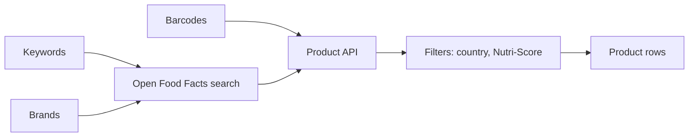

# Open Food Facts Scraper: Food Products, Nutrition and Ingredients

[](https://apify.com/Turboextract/open-food-facts)
[](LICENSE)
[](#pricing)

**Export food products from Open Food Facts by keyword, barcode, brand or country, with name, brand, quantity, Nutri-Score, NOVA group, Eco-Score, ingredients, allergens, additives, nutrients per 100 g, labels, stores and image.** Power a food app, compare products or research a category. No API key.

In one test, "protein bar" matched 8,745 products. Of the 20 most scanned, 16 are ultra-processed (NOVA 4), with an average of 25 g of protein and 16.6 g of sugar per 100 g.

**Try it now →** [apify.com/Turboextract/open-food-facts](https://apify.com/Turboextract/open-food-facts)

---

## Why this exists

- Open Food Facts search shows products a page at a time.
- Nutrients, scores and ingredients need a call per product.
- Commercial nutrition APIs charge $100+ a month.
- Food apps and researchers need clean rows by keyword or barcode.

---

## Who this is for

- **Food and health app makers** needing product and nutrition data
- **CPG and retail teams** comparing a category and its brands
- **Dietitians and researchers** studying ingredients and scores
- **Ecommerce teams** enriching product listings by barcode
- **Journalists** checking claims about food products

---

## What you get

```json
{
  "barcode": "5060088700112",
  "name": "Protein Bars Cocoa Hazelnut",
  "brands": ["nakd."],
  "quantity": "135 g",
  "url": "https://world.openfoodfacts.org/product/5060088700112",
  "nutriscore": "C",
  "novaGroup": 4,
  "ecoscore": "C",
  "energyKcal100g": 424,
  "sugars100g": 28,
  "protein100g": 16,
  "salt100g": 0.01,
  "ingredients": "Dates (38%), Peanuts (35%), Chicory fibre (10%), Peanut flour (8%), Hazelnuts (5%)...",
  "allergens": ["nuts", "peanuts"],
  "labels": ["vegan", "no-gluten", "no-added-sugar"],
  "countries": ["belgium", "france", "united-kingdom"],
  "source": "search: protein bar"
}
```

---

## How it works



---

## Quick start

1. Click **Try for free**.
2. Add **Search keywords**, like `oat milk`, **Barcodes**, or **Brands**.
3. Optional: set **Country**, like `united-states`, and **Nutri-Score**.
4. Click **Start**, then export to CSV, JSON, Excel or Google Sheets.

### API

```bash
curl -X POST "https://api.apify.com/v2/acts/Turboextract~open-food-facts/run-sync-get-dataset-items?token=YOUR_TOKEN" \
  -H "Content-Type: application/json" \
  -d '{"searchQueries": ["energy drink"], "country": "united-kingdom", "maxResults": 50}'
```

### Python

```python
from apify_client import ApifyClient

client = ApifyClient("YOUR_TOKEN")
run = client.actor("Turboextract/open-food-facts").call(run_input={
    "searchQueries": [],
    "barcodes": ["3017624010701", "5449000000996"],
})
for p in client.dataset(run["defaultDatasetId"]).iterate_items():
    print(p["name"], p["nutriscore"], p["sugars100g"])
```

---

## Input fields

| Field | Default | What it does |
|---|---|---|
| `searchQueries` | protein bar | Product search keywords |
| `barcodes` | – | EAN or UPC codes |
| `brands` | – | Brand names, like kind or danone |
| `country` | – | Only products sold in this country |
| `nutriscore` | any | Only this Nutri-Score, A to E |
| `maxResults` | 20 | Total cap per run |

---

## Pricing

**$0.0005 per product delivered.** 1,000 products cost $0.50.

| Option | 1,000 products |
|---|---|
| **Open Food Facts Scraper** | **$0.50** |
| Commercial nutrition APIs | $100+ a month |

---

## Common use cases

- **Food apps**: nutrition and allergens for products users scan
- **Category reviews**: every protein bar or plant milk with scores and sugar
- **Brand audits**: a brand's whole range with Nutri-Score and NOVA group
- **Listing enrichment**: ingredients and images by barcode
- **Research**: ultra-processed share in a category or country

---

## Tips for best results

- Results are sorted by how often shoppers scan them, so popular products come first.
- Each product takes about 2 seconds, so larger runs take a few minutes.
- Country names use the Open Food Facts form, like `united-states` or `france`.
- Some products have no Nutri-Score because the label data is incomplete.

---

## Pairs well with

- [Product Recall Monitor](https://apify.com/Turboextract/product-recall-monitor): food recalls from regulators
- [Shopify Store Products](https://apify.com/Turboextract/shopify-store-products): prices from DTC food brands
- [Open Library Books](https://apify.com/Turboextract/open-library-books): another open database export

---

## FAQ

**Do I need an Open Food Facts account?** No. The actor uses the public Open Food Facts APIs.

**Can I use the data commercially?** Yes, under the Open Database License (ODbL). Credit Open Food Facts and share changes to the database itself.

**Why are some nutrients empty?** Contributors have not entered them for that product.

**How fresh is the data?** It is read live on every run.

**How many products are there?** Open Food Facts has millions of products from over 150 countries.

---

## SEO keywords

Open Food Facts scraper, food product API, nutrition data export, barcode lookup API, Nutri-Score data, food ingredients database, NOVA ultra-processed food data, food products to CSV, grocery product data, allergen database

---

## Support

- Actor page: https://apify.com/Turboextract/open-food-facts
- Issues and questions: open an issue in this repo
- Community Discord: https://discord.gg/8SrXSCpvgj

Built and maintained by [Turboextract](https://apify.com/Turboextract) on the Apify platform.

---

## License

The documentation and examples in this repository are MIT licensed. The actor itself runs on the Apify platform.
